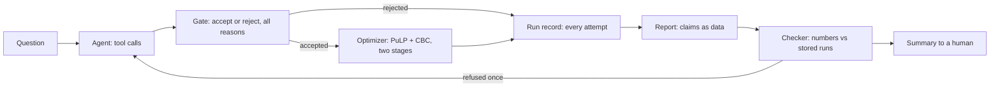

# happy_toad

A small synthetic reference build of a budget-constrained capital-allocation optimizer, with an
agent layer that answers plain-English questions by running scenarios and reporting checked
numbers. All data is synthetic and generated from a seed. It is not a product.

**Status:** M1 to M3 complete (tag v0.3.1); M2B and M4 to M6 planned.

## Why
Planners ask follow-up questions of an optimizer: what if the budget were larger, what if this
candidate were forced in, why was this request rejected. An agent can run those scenarios and
report only numbers that trace back to a stored run, with a checker refusing any number it cannot
trace. A human decides; the agent approves nothing.

## Architecture

The agent approves nothing: it runs scenarios and reports; a human decides.

## Demo excerpt (live, question c)
From the live transcript `20261114T210201-5276b834` (commit 78ba102, DeepSeek V4 Flash 0731 on
Baseten; account id redaction applied, nothing to redact here), shortened:
```text
Question: On v1 at a total budget of 600, force in the three most expensive candidates:
          C033, C034 and C024.
Tool call: run_scenario {"input_version": "v1", "budget": 600,
                         "force_in": ["C033", "C034", "C024"]}
Result:    outcome rejected, FORCED_COST_EXCEEDS_BUDGET: "must-fund 311.44 plus forced-in
           385.57 exceeds the budget 600.0"; required_minimum_budget 697.01
Report:    "... was rejected. The forced-in candidates combined with must-fund projects exceed
           the budget. The budget must be at least 697.01 for this scenario to be feasible."
           claims: status = rejected; required_minimum_budget = 697.01
Checker:   ok=True, claims 2/2 valid, numbers 2/2 matched (after one refusal: 297.57 and
           311.44 in the first summary had no claim)
```

## How it was built
Built with Claude Code. Working rule: spec first (docs/SPEC.md), tests written before code, and
every decision logged in docs/DEVLOG.md, including the ones the owner did not specify.

## Run it
```
uv sync
uv run happy-toad generate --seed 42           # synthetic inputs in data/inputs/
uv run happy-toad sweep data/inputs/v1.json    # budget sweep table
export OPENROUTER_API_KEY=...                  # only for ask
uv run happy-toad ask "Using input version v1, compare budget 800 with budget 1500"
uv run pytest
```

## Layout
`src/happy_toad/{data,engine,services,agent}`, `cli.py`, `report.py`, `tests/`, `scripts/`, `docs/{SPEC,DECISIONS,DEVLOG}.md`.

## Milestone 1: data and the optimizer core

A small synthetic reference build of a budget-constrained capital-allocation optimizer. Given
synthetic sectors with shortfalls, candidate solutions that relieve them, and a budget, it picks
which candidates to fund so that weighted shortfall relief is as large as possible, using PuLP
with CBC. It is not a product. All data is synthetic and generated from a seed.

What M1 contains: pydantic schemas, a seeded generator, load-time checks, the optimization model,
known-answer tests and a CLI budget sweep. There is no agent layer yet.

### Run it
```
uv sync                                        # install (Python 3.12, locked)
uv run happy-toad generate --seed 42           # writes data/inputs/v1.json, v2.json, changes_v1_to_v2.json
uv run happy-toad sweep data/inputs/v1.json    # 20 budgets, 5% to 100% of candidate cost
uv run happy-toad sweep data/inputs/v1.json --budgets 700,1400,2100   # total budgets, incl. must-fund
uv run pytest                                  # tests (5-15 s: the scale tests run real CBC solves)
uv run ruff check . && uv run ruff format --check .
```
The sweep prints one row per budget: `budget` (total, including must-fund), `must_fund`, `status`,
`spend` (candidate spend only), `weighted relief`, `# selected`, `resolved` (sectors whose
relief reaches their shortfall, out of all sectors) and `% resolved`. Example (seed 42):
```
│ 700.00 │   311.44 │Optimal │ 387.04 │1129.715 │       16 │   20/80 │    25.0%│
│1400.00 │   311.44 │Optimal │1081.80 │1910.070 │       23 │   42/80 │    52.5%│
```
Generated JSON is gitignored; regenerate it with the same seed (same seed, identical files).

### Units
Shortfall and offload share one abstract **need unit**; cost and budget share one abstract **cost
unit**. Nothing is converted, and the numbers carry no real-world meaning. A candidate's offload
on a sector is the amount of that sector's shortfall it relieves if funded; relief per sector is
`min(shortfall, sum of funded offloads)`.

### What the model does
- Maximizes weighted relief, `sum over sectors of weight * relief`, within the budget left after
  must-fund projects (`avail = budget - must_fund_total`).
- Two stages (docs/DECISIONS.md D2): stage 1 finds the best relief, stage 2 finds the minimum spend
  that delivers it (within a tiny slack), so nothing is funded for nothing.
- **The weight `1 / (trigger_year - base_year + 1)` is a modelling assumption, not a calibrated
  value.** A sector that triggers in the base year (2027) weighs 1, one a year later 1/2, and so on.
- Optional per-market spend floors and caps (`solve(..., market_floor_mult=, market_cap_mult=,
  fair_share_blend=)`), off by default; see docs/SPEC.md, "Market floors and caps". They are not
  yet options of the `sweep` command.

### What is checked and measured
- Load-time checks on every input (references resolve, ids unique, costs positive, finite numbers,
  trigger year not before the base year, content hash matches).
- Known-answer tests 1-11 (docs/SPEC.md), scale regression tests on generated data, and generator
  properties measured on seeds 1, 2, 3, 42 within stated tolerances (market counts, type spend
  shares, coverage, resolvable fraction, trigger-year ordering).
- `scripts/compare_greedy.py` compares the optimizer with a greedy relief-per-cost baseline; the
  gap on seeds 42, 1, 2 is between 0 and about 4% of relief (docs/DEVLOG.md).

### Limitations
- The synthetic data is a stand-in. The shortfall magnitude (uniform 10-100 per sector) is an
  assumption, as are the offload shares, costs and trigger-year profiles.
- The planning window is 5 years (2027-2031) and weights are `1/t`; both are modelling choices.
- Partial relief counts: a candidate that relieves part of a sector's shortfall earns partial
  credit, and `% resolved` counts only sectors fully relieved.
- 80 sectors is small: a production region would have far more sectors, and the solve times here
  (well under a second) say nothing about that scale.
- The share of a multi-sector candidate's rows in its own market (85%) was checked on seeds 1, 2,
  3, 42 only; on other seeds it varies (26 of 300 seeds fall outside the test tolerance).
- Market floors and caps count a cross-market candidate's full cost in one market, the market of
  its largest offload row (docs/DECISIONS.md D4); about 10-15 of ~51 generated candidates are
  cross-market.
- Single-threaded CBC with a 30 s limit in total across both stages; a time-limit stop is reported
  as `TimeLimit`, never `Optimal`.

## Milestone 2A: decision services

The deterministic services a later agent layer will call. There is no agent and no LLM call here.
A request goes through a **gate**, then the solve, and every attempt (accepted, rejected or
failed) leaves one JSON record in `runs/` (gitignored).

```python
from happy_toad.services.request import SolveRequest
from happy_toad.services.run import run_request

record = run_request(
    SolveRequest(
        input_version="v1",  # data/inputs/v1.json
        budget=1400,  # total, including must-fund
        force_out=["C001"],  # optional: force_in / force_out
        market_cap_mult=1.5,  # optional floors and caps (None = off)
        region_total_sectors=12345,  # optional, reporting only (made-up value)
        target_pct_resolved=50,  # optional: reported as met / not met, no search
        label="demo",
    )
)
record.outcome, record.result.status, record.result.pct_resolved, record.result.target_met
```

- **Gate** (`check_request`): returns *all* problems with codes `VERSION_NOT_FOUND`,
  `BUDGET_NOT_POSITIVE`, `BUDGET_ABOVE_CAP` (1.5 x candidate cost plus must-fund),
  `UNKNOWN_CANDIDATE`, `FORCE_CONFLICT`, `FORCED_COST_EXCEEDS_BUDGET`.
- **Infeasible results** carry a cause when it can be known (`FORCED_COST_EXCEEDS_BUDGET`,
  `FLOORS_EXCEED_BUDGET`, `CAP_BELOW_FLOOR`, `FORCED_IN_EXCEEDS_CAP`, `FLOOR_UNREACHABLE`),
  otherwise `CAUSE_UNKNOWN`. A guess is never presented as a plan.
- **Run record**: run id, request and request hash, input version and content hash, settings,
  outcome, reasons or error, result summary, timing. The same request run twice has two run ids and
  one request hash.
- **Unresolved sectors**: sectors still short after the plan (shortfall minus relief above 1e-6),
  largest weighted gap first.
- **Sweep**: `uv run happy-toad sweep data/inputs/v1.json --market-floor-mult 0.5
  --market-cap-mult 1.5`. Infeasible budgets are listed below the table with their cause.
- The sweep table needs about 100 terminal columns to avoid truncated cells.

Limitations specific to M2A: no search for the smallest budget that meets a target (planned
for M2B); the "cause unknown" label also covers infeasibility that comes from how candidate costs
add up inside a market (for example floors that no combination of whole candidates can meet within
the budget); `region_total_sectors` only changes the reported percentage.

## Milestone 3: the agent (`happy-toad ask`)
Checkpoint version: tag v0.3.1.

A thin agent layer over the M2A services: it turns a plain-English question into tool calls
(`list_input_versions`, `run_scenario`, `get_run`, `compare_runs`, `submit_report`), then submits a
report of claims (metric, value, unit, run id) that a checker compares with the stored runs and
with every number in the summary. Mismatches go back to the model once; a report that still fails
is shown as UNVERIFIED. It reaches the model through OpenRouter's OpenAI-compatible API.
- Set `OPENROUTER_API_KEY` in your environment (never stored, logged or put in a transcript).
- `uv run happy-toad ask "Using input version v1, compare budget 800 with budget 1500" --profile smoke`
  uses a free model only to check the loop; `--profile demo` (default) uses the pinned paid model.
- Each conversation is saved as JSON in `transcripts/` (gitignored) with tool calls, check results,
  tokens, cost when OpenRouter reports it, and the provider that served each response.
- Demo model: DeepSeek V4 Flash 0731 via OpenRouter, pinned to the host Baseten (fp8) with Baidu
  (fp8) as the only backup, reasoning off. In a real deployment, which models and providers are
  approved is the customer's decision. The three demo questions each ended with every claim
  checked in the live run on commit 78ba102, the commit tagged v0.3.1 (transcripts
  20261114T210145-c04c55d4, 20261114T210154-e11f5b1d, 20261114T210201-5276b834).

### Model comparison (one round, synthetic data)
75 conversations: 5 models x 3 demo questions x 5 runs, all on one frozen state (commit 78ba102,
after the code-review fixes: same system prompt, tools, checker and loop for every run). Rule, set
before the round: the cheapest model checked in at least 4 of 5 runs on every question; costs
within 2x count as a tie, broken by fewer refusals, then clearer host precision; GLM must also
average under about 15 s per question; the Sonnet reference decides only if none of the other four
passes. Cost is tokens times the per-token prices OpenRouter listed at run time, for all 15 runs of
a model. Refusals count only refused reports that the model went on to correct.

**The Sonnet reference was the most reliable (15 of 15 in both rounds) at about 30x the cost;
DeepSeek was the cheapest model to pass the rule. Differences between the other models are within
run-to-run noise at five runs per cell.**

| Model (host, precision as listed) | Checked a / b / c | Refusals | Cost, 15 runs | Mean s per question |
|---|---|---|---|---|
| Gemma 4 31B (Crusoe or Novita, bf16) | 1 / 0 / 5 | 7 | $0.0583 | 19.4 |
| Gemini 2.5 Flash Lite (Google AI Studio, not listed) | 1 / 3 / 5 | 12 | $0.0249 | 7.0 |
| DeepSeek V4 Flash 0731 (Baseten, fp8) | 4 / 4 / 5 | 10 | $0.0170 | 9.1 |
| GLM 5.3 Flash (Z.AI, fp8), reasoning effort low: not equal terms | 2 / 5 / 5 | 11 | $0.0075 | 19.2 |
| Claude Sonnet 5.5 reference (Anthropic, not listed), reasoning effort low: not equal terms | 5 / 5 / 5 | 1 | $0.5238 | 8.5 |

Under the rule, only DeepSeek passes: Gemma, Gemini and GLM miss the 4-of-5 bar on question a
(Gemma also on b), and GLM also misses the latency bar. GLM and Sonnet cannot switch reasoning
off, so they ran at the lowest effort and are not on equal terms with the others. Details and the
failure reasons per model are in docs/DEVLOG.md.
- An earlier round on a slightly different checker (commit 4a6572b, before the code-review fixes)
  gave different counts out of 15: DeepSeek 15, GLM 15, Gemini 10, Gemma 10. With five runs per
  cell, the comparison is suggestive, not conclusive.
- DeepSeek V4 Flash 0731 is served at fp8 as listed by the hosts; the checkpoint ships mixed
  fp8/fp4 per its model card.
- Reporting caveat: OpenRouter lists two Baseten endpoints for this model under the same name
  (fp8 and fp32), and a response names only the provider, so transcripts show Baseten turns as
  "fp32|fp8". The pin names the fp8 endpoint.
- Limitations: five runs per cell is a small sample, not a statistical test, and the round was run
  once. The checker verifies numbers against stored runs, not whether the model's words are a fair
  reading of them; it does not check direction words in prose ("more", "less"), so a correct number
  with the wrong direction would pass, and it does not check wording such as "rejected" versus
  "infeasible". The defaults count (units and entities the schema filled in) records schema
  behaviour and is not a quality signal. Claims are about whole plans only; differences are
  allowed only as `compare_runs` reports them, never computed by the agent.
- Also not checked yet, logged for the M4 fix pass: candidate ids named in the summary are not
  checked against the runs, and a count claimed as a whole-valued float (2.0 instead of 2) is
  rejected.

## What is next (planned, not done)
- M2B: diagnostics (for example the smallest budget that meets a target).
- M4: evaluations.
- M5: revision analysis.
- M6: an MCP server.
