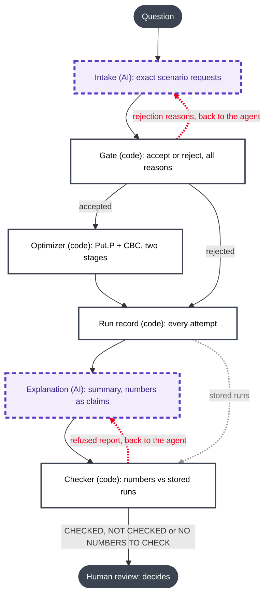
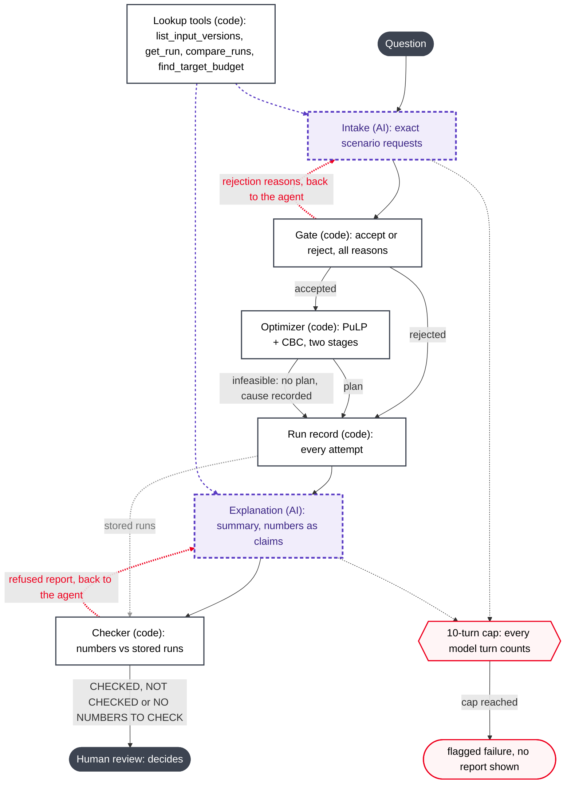
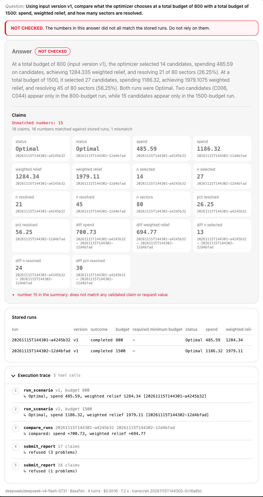

# Capital Planning Scenario Assistant

A small synthetic reference build of a budget-constrained capital-allocation optimizer, with an
agent layer that answers plain-English questions by running scenarios and reporting checked
numbers. All data is synthetic and generated from a seed. It is not a product. The Python package and
command keep the working name `happy_toad` / `happy-toad`.

Plan capital budgets but don't program? Start with the [Guide for planners](docs/GUIDE.md).

**Status:** M1 to M5 and M2B complete (tag v0.6); M6 and M7 planned.

## Why
Planners ask follow-up questions of an optimizer: what if the budget were larger, what if this
candidate were forced in, why was this request rejected. An agent can run those scenarios and
report the results. A checker compares each number in the summary to the stored runs, and an
answer it cannot verify is shown as not checked. A human decides; the agent approves nothing.

## Architecture

In words: A question goes to Intake (AI), which writes a structured request. The Gate (code) accepts or rejects it, and rejection reasons go back to the AI. Accepted requests go to the Optimizer (code: PuLP with CBC, two stages). Every attempt, accepted or rejected, is stored in the Run record (code). The Explanation (AI) writes a summary with its numbers as claims. The Checker (code) compares those numbers with the stored runs, and a refused report goes back to the AI. The answer, labeled CHECKED, NOT CHECKED, or NO NUMBERS TO CHECK, goes to a person, who decides.

Purple dashed boxes are the AI model (one agent, two jobs); white boxes are plain code. Red dotted
arrows are the two ways work goes back to the agent; the grey dotted arrow is the checker reading
the stored runs. The agent approves nothing: it runs scenarios and reports; a human decides.

<details>
<summary>Detailed flow</summary>

Adds what the simple diagram leaves out: the infeasible path out of the Optimizer, the lookup
tools the agent can call, and the 10-turn cap that ends a conversation with no report.



</details>

## Demo excerpt (live, question c)
The live transcript `20261114T210201-5276b834` (run on v0.3.1, DeepSeek V4 Flash 0731 on
Baseten), shown in the compact `ask` output; nothing shortened, no account id to redact:
```text
$ uv run happy-toad ask "On v1 at a total budget of 600, force in the three most expensive candidates: C033, C034 and C024."
run_scenario v1, budget 600, force in C033, C034, C024 -> rejected FORCED_COST_EXCEEDS_BUDGET, minimum budget 697.01 [20261114T210203-96d94d4c]
submit_report 2 claims -> refused (2 problems)
submit_report 2 claims -> accepted
╭─  CHECKED  ──────────────────────────────────────────────────────────────────────────────────╮
│ The requested scenario on v1 at a total budget of 600 with C033, C034, and C024 forced in    │
│ was rejected. The forced-in candidates combined with must-fund projects exceed the budget.   │
│ The budget must be at least 697.01 for this scenario to be feasible. No results were         │
│ produced because the run was not accepted.                                                   │
╰──────────────────────────────────────────────────────────────────────────────────────────────╯
Failed the check once, then corrected: unmatched numbers 297.57, 311.44
2 claims | 2 numbers checked | 0 mismatches
deepseek/deepseek-v4-flash-0731 | BaseTen | 3 turns | $0.0010 | 3.8 s
```
`--verbose` shows every tool result and every check instead.

Web: open `web/replay.html` in a browser for a replay of three real runs (two that passed the check, one that failed it; no key, no network), or run `OPENROUTER_API_KEY=... uv run python -m web.server` for the local live page at http://127.0.0.1:8765 (details in `web/README.md`).

## How it was built
Built with Claude Code. Working rule: spec first (docs/SPEC.md), tests written before code, and
every decision logged in docs/DEVLOG.md, including the ones the owner did not specify.

## Run it
Needs [uv](https://docs.astral.sh/uv/) and Python 3.12 or later (`uv python install 3.12` if you
do not have it).
```
git clone https://github.com/ChuLion/happy_toad.git && cd happy_toad
uv sync
uv run happy-toad generate --seed 42           # synthetic inputs in data/inputs/
uv run happy-toad sweep data/inputs/v1.json    # budget sweep table
export OPENROUTER_API_KEY=...                  # only for ask; your key
uv run happy-toad ask "Using input version v1, compare budget 800 with budget 1500"
uv run pytest
```
- The CLI does not read `.env`; it reads `OPENROUTER_API_KEY` from the environment, so export it
  (or load a `.env` copied from `.env.example` with `set -a; . ./.env; set +a`).
- The default `ask` profile is a paid model and needs OpenRouter credit (the demo questions cost
  $0.0010 to $0.0019 each in the live runs). `--profile smoke` uses a free model, only to check
  that the loop runs.

## Layout
`src/happy_toad/{data,engine,services,agent}`, `cli.py`, `report.py`, `tests/`, `scripts/`, `docs/{SPEC,DECISIONS,DEVLOG}.md`.

## Milestone 1: data and the optimizer core

A small synthetic reference build of a budget-constrained capital-allocation optimizer. Given
synthetic sectors with shortfalls, candidate solutions that relieve them, and a budget, it picks
which candidates to fund so that weighted shortfall relief is as large as possible, using PuLP
with CBC. It is not a product. All data is synthetic and generated from a seed.

What M1 contains: pydantic schemas, a seeded generator, load-time checks, the optimization model,
known-answer tests and a CLI budget sweep. There is no agent layer yet.

### Run it
```
uv sync                                        # install (Python 3.12, locked)
uv run happy-toad generate --seed 42           # writes data/inputs/v1.json, v2.json, changes_v1_to_v2.json
uv run happy-toad sweep data/inputs/v1.json    # 20 budgets: must-fund plus 5% to 100% of candidate cost
uv run happy-toad sweep data/inputs/v1.json --budgets 700,1400,2100   # total budgets, incl. must-fund
uv run pytest                                  # tests (5-15 s: the scale tests run real CBC solves)
uv run ruff check . && uv run ruff format --check .
```
The sweep prints one row per budget: `budget` (total, including must-fund), `must_fund`, `status`,
`spend` (candidate spend only), `weighted relief`, `# selected`, `resolved` (sectors whose
relief reaches their shortfall, out of all sectors) and `% resolved`. Example (seed 42):
```
│ 700.00 │   311.44 │Optimal │ 387.04 │1129.715 │       16 │   20/80 │    25.0%│
│1400.00 │   311.44 │Optimal │1081.80 │1910.070 │       23 │   42/80 │    52.5%│
```
Generated JSON is gitignored; regenerate it with the same seed (same seed, identical files).

### Units
Shortfall and offload share one abstract **need unit**; cost and budget share one abstract **cost
unit**. Nothing is converted, and the numbers carry no real-world meaning. A candidate's offload
on a sector is the amount of that sector's shortfall it relieves if funded; relief per sector is
`min(shortfall, sum of funded offloads)`.

### What the model does
- Maximizes weighted relief, `sum over sectors of weight * relief`, within the budget left after
  must-fund projects (`avail = budget - must_fund_total`).
- Two stages (docs/DECISIONS.md D2): stage 1 finds the best relief, stage 2 finds the minimum spend
  that delivers it (within a tiny slack), so nothing is funded for nothing.
- **The weight `1 / (trigger_year - base_year + 1)` is a modelling assumption, not a calibrated
  value.** A sector that triggers in the base year (2027) weighs 1, one a year later 1/2, and so on.
- Optional per-market spend floors and caps (`solve(..., market_floor_mult=, market_cap_mult=,
  fair_share_blend=)`), off by default; see docs/SPEC.md, "Market floors and caps". They are not
  yet options of the `sweep` command.

### What is checked and measured
- Load-time checks on every input (references resolve, ids unique, costs positive, finite numbers,
  trigger year not before the base year, content hash matches).
- Known-answer tests 1-11 (docs/SPEC.md), scale regression tests on generated data, and generator
  properties measured on seeds 1, 2, 3, 42 within stated tolerances (market counts, type spend
  shares, coverage, resolvable fraction, trigger-year ordering).
- `scripts/compare_greedy.py` compares the optimizer with a greedy relief-per-cost baseline; the
  gap on seeds 42, 1, 2 is between 0 and about 4% of relief (docs/DEVLOG.md).

### Limitations
- The synthetic data is a stand-in. The shortfall magnitude (uniform 10-100 per sector) is an
  assumption, as are the offload shares, costs and trigger-year profiles.
- The planning window is 5 years (2027-2031) and weights are `1/t`; both are modelling choices.
- Partial relief counts: a candidate that relieves part of a sector's shortfall earns partial
  credit, and `% resolved` counts only sectors fully relieved.
- 80 sectors is small: a production region would have far more sectors, and the solve times here
  (well under a second) say nothing about that scale.
- The share of a multi-sector candidate's rows in its own market (85%) was checked on seeds 1, 2,
  3, 42 only; on other seeds it varies (26 of 300 seeds fall outside the test tolerance).
- Market floors and caps count a cross-market candidate's full cost in one market, the market of
  its largest offload row (docs/DECISIONS.md D4); about 10-15 of ~51 generated candidates are
  cross-market.
- Single-threaded CBC with a 30 s limit in total across both stages; a time-limit stop is reported
  as `TimeLimit`, never `Optimal`.

## Milestone 2A: decision services

The deterministic services a later agent layer will call. There is no agent and no LLM call here.
A request goes through a **gate**, then the solve, and every attempt (accepted, rejected or
failed) leaves one JSON record in `runs/` (gitignored).

```python
from happy_toad.services.request import SolveRequest
from happy_toad.services.run import run_request

record = run_request(
    SolveRequest(
        input_version="v1",  # data/inputs/v1.json
        budget=1400,  # total, including must-fund
        force_out=["C001"],  # optional: force_in / force_out
        market_cap_mult=1.5,  # optional floors and caps (None = off)
        region_total_sectors=12345,  # optional, reporting only (made-up value)
        target_pct_resolved=50,  # optional: reported as met / not met, no search
        label="demo",
    )
)
record.outcome, record.result.status, record.result.pct_resolved, record.result.target_met
```

- **Gate** (`check_request`): returns *all* problems with codes `VERSION_NOT_FOUND`,
  `BUDGET_NOT_POSITIVE`, `BUDGET_ABOVE_CAP` (1.5 x candidate cost plus must-fund),
  `UNKNOWN_CANDIDATE`, `FORCE_CONFLICT`, `FORCED_COST_EXCEEDS_BUDGET`.
- **Infeasible results** carry a cause when it can be known (`FORCED_COST_EXCEEDS_BUDGET`,
  `FLOORS_EXCEED_BUDGET`, `CAP_BELOW_FLOOR`, `FORCED_IN_EXCEEDS_CAP`, `FLOOR_UNREACHABLE`),
  otherwise `CAUSE_UNKNOWN`. A guess is never presented as a plan.
- **Run record**: run id, request and request hash, input version and content hash, settings,
  outcome, reasons or error, result summary, timing. The same request run twice has two run ids and
  one request hash.
- **Unresolved sectors**: sectors still short after the plan (shortfall minus relief above 1e-6),
  largest weighted gap first.
- **Sweep**: `uv run happy-toad sweep data/inputs/v1.json --market-floor-mult 0.5
  --market-cap-mult 1.5`. Infeasible budgets are listed below the table with their cause.
- The sweep table needs about 100 terminal columns to avoid truncated cells.

Limitations specific to M2A: no search for the smallest budget that meets a target (planned
for M2B); the "cause unknown" label also covers infeasibility that comes from how candidate costs
add up inside a market (for example floors that no combination of whole candidates can meet within
the budget); `region_total_sectors` only changes the reported percentage.

## Milestone 2B: target-budget search
"What total budget reaches 50% of sectors resolved?" is answered with the **cheapest plan** that
resolves at least that many sectors (50% of 80 is 40): a separate optimization that minimizes
candidate spend subject to the target, with ties going to the most weighted relief. The answer is
a total budget including must-fund projects, rounded up to the cent. The normal optimizer then
runs at that budget, so the answer also shows what the usual plan does with the money.

Why not "the smallest budget at which the optimizer reaches 50%": the number of resolved sectors
is not monotonic in budget. On v1, one more unit of budget resolves fewer sectors at 148 budgets
(981.44 resolves 30, 982.44 resolves 26), because the optimizer maximizes weighted relief and
partial relief counts. On v1 the cheapest plan for 50% needs 1145.21; the optimizer first reaches
50% at about 1329.

```
uv run happy-toad target-budget data/inputs/v1.json --target 50
```
Exit codes: 0 found or unreachable, 1 rejected, 2 invalid request, 3 time limit. The agent's tool is
`find_target_budget`; its new metrics (`target_budget`, `target_sectors`, `max_resolvable`,
`max_pct_resolvable`) are checked like the others. A target above what any plan can reach gives
`TARGET_UNREACHABLE` with the maximum. Market floors and caps are not supported in the search.

## Milestone 3: the agent (`happy-toad ask`)
Checkpoint version: tag v0.3.2 (v0.3.1 plus the compact `ask` output and README fixes; the agent,
tools, prompt and checker are the same as v0.3.1, where the live demo ran).

A thin agent layer over the M2A services: it turns a plain-English question into tool calls
(`list_input_versions`, `run_scenario`, `get_run`, `compare_runs`, `submit_report`, and since M2B
`find_target_budget`), then submits a
report of claims (metric, value, unit, run id) that a checker compares with the stored runs and
with every number in the summary. Mismatches go back to the model once; a report that still fails
is shown as NOT CHECKED (status `unverified` in the transcript and in `--verbose`). It reaches the model through OpenRouter's OpenAI-compatible API.
- Set `OPENROUTER_API_KEY` in your environment (never stored, logged or put in a transcript).
- `uv run happy-toad ask "Using input version v1, compare budget 800 with budget 1500" --profile smoke`
  uses a free model only to check the loop; `--profile demo` (default) uses the pinned paid model.
- Each conversation is saved as JSON in `transcripts/` (gitignored) with tool calls, check results,
  tokens, cost when OpenRouter reports it, and the provider that served each response.
- Demo model: DeepSeek V4 Flash 0731 via OpenRouter, pinned to the host Baseten (fp8) with Baidu
  (fp8) as the only backup, reasoning off. In a real deployment, which models and providers are
  approved is the customer's decision. The three demo questions each ended with every claim
  checked in the live run on commit 78ba102, the commit tagged v0.3.1 (transcripts
  20261114T210145-c04c55d4, 20261114T210154-e11f5b1d, 20261114T210201-5276b834).

### Model comparison (one round, synthetic data)
75 conversations: 5 models x 3 demo questions x 5 runs, all on one frozen state (commit 78ba102,
after the code-review fixes: same system prompt, tools, checker and loop for every run). Rule, set
before the round: the cheapest model checked in at least 4 of 5 runs on every question; costs
within 2x count as a tie, broken by fewer refusals, then clearer host precision; GLM must also
average under about 15 s per question; the Sonnet reference decides only if none of the other four
passes. Cost is tokens times the per-token prices OpenRouter listed at run time, for all 15 runs of
a model. Refusals count only refused reports that the model went on to correct.

**The Sonnet reference checked 15 of 15 in each of the two rounds. DeepSeek was the cheapest model
to pass the rule, roughly 30 to 40 times cheaper than Sonnet (30.8x in this round, 39x in the
earlier one). With five runs per cell, the differences between the other models are suggestive,
not conclusive.**

| Model (host, precision as listed) | Checked a / b / c | Refusals | Cost, 15 runs | Mean s per question |
|---|---|---|---|---|
| Gemma 4 31B (Crusoe or Novita, bf16) | 1 / 0 / 5 | 7 | $0.0583 | 19.4 |
| Gemini 2.5 Flash Lite (Google AI Studio, not listed) | 1 / 3 / 5 | 12 | $0.0249 | 7.0 |
| DeepSeek V4 Flash 0731 (Baseten, fp8) | 4 / 4 / 5 | 10 | $0.0170 | 9.1 |
| GLM 5.3 Flash (Z.AI, fp8), reasoning effort low: not equal terms | 2 / 5 / 5 | 11 | $0.0075 | 19.2 |
| Claude Sonnet 5.5 reference (Anthropic, not listed), reasoning effort low: not equal terms | 5 / 5 / 5 | 1 | $0.5238 | 8.5 |

Under the rule, only DeepSeek passes: Gemma, Gemini and GLM miss the 4-of-5 bar on question a
(Gemma also on b), and GLM also misses the latency bar. GLM and Sonnet cannot switch reasoning
off, so they ran at the lowest effort and are not on equal terms with the others. Details and the
failure reasons per model are in docs/DEVLOG.md.
- An earlier round on a slightly different checker (commit 4a6572b, before the code-review fixes)
  gave different counts out of 15: DeepSeek 15, GLM 15, Gemini 10, Gemma 10. With five runs per
  cell, the comparison is suggestive, not conclusive.
- DeepSeek V4 Flash 0731 is served at fp8 as listed by the hosts; the checkpoint ships mixed
  fp8/fp4 per its model card.
- Reporting caveat: OpenRouter lists two Baseten endpoints for this model under the same name
  (fp8 and fp32), and a response names only the provider, so transcripts show Baseten turns as
  "fp32|fp8". The pin names the fp8 endpoint.
- Limitations: five runs per cell is a small sample, not a statistical test, and the round was run
  once. The checker verifies numbers against stored runs, not whether the model's words are a fair
  reading of them; it does not check direction words in prose ("more", "less"), so a correct number
  with the wrong direction would pass, and it does not check wording such as "rejected" versus
  "infeasible". The defaults count (units and entities the schema filled in) records schema
  behaviour and is not a quality signal. Claims are about whole plans only; differences are
  allowed only as `compare_runs` reports them, never computed by the agent.
- Changed in the M4 fix pass (group 1, checker): a count claimed as a whole-valued float (2.0)
  is accepted as 2; `compare_runs` counts added and dropped candidates (`n_added`, `n_dropped`,
  claimable); the region percent is a claimable metric (`pct_of_region`); only the planning-window
  years (2027-2031) are skipped, so "a budget of 2000" is checked; numbers in the request values
  and rejection messages of the conversation's runs are allowed, numbers only in the question are
  not; a candidate id in the summary must be in the selection or force lists of a run made in
  the conversation (an id that is only in the question is refused).
- Changed in the M4 fix pass (group 2, prompt, tools and gate): the prompt says a gate refusal
  is "rejected", not "infeasible" (a checker rule for it was dropped after it refused a correct
  denial); rule 12 keeps the higher-budget caveat as its own sentence and ends with
  the offer; rule 7 gives rounding examples; `target_pct_resolved` is described as report-only;
  with no version named the agent uses v1 and says so; the gate names a change list as such; the
  unresolved count is claimable (`n_unresolved`) and "of N sectors" asks for an `n_sectors`
  claim.

What a failed check looks like (a real run: the summary said 15 candidates appear only in the
1500 run, a number no claim backs, so the answer is shown as NOT CHECKED):



## Milestone 4: evaluations (`happy-toad eval`)
19 questions, each asked 5 times on the demo model (DeepSeek V4 Flash 0731), graded on three
things: the right runs (tools and arguments), the right numbers (against ground truth computed by
`evals/truth.py`, which shares no code with the engine, not against the agent's own runs) and the
right behaviour (allowed label, required phrases). Wording that should never appear ("approve",
"recommend") is listed for a person to review, not failed automatically, because it also appears
in correct refusals. Conversations ended by a provider error are counted apart and left out of the
rates. Official rounds run on a clean, committed tree; reports are in `evals/rounds/`.

| Round | Change before it | Pass | Runs | Numbers | Behaviour | Checked | First pass | Cost |
|---|---|---|---|---|---|---|---|---|
| Baseline | (none) | 86% | 95% | 94% | 91% | 80% | 66% | $0.094 |
| Round 2 | group 1: checker fixes | 84% | 94% | 94% | 86% | 76% | 54% | $0.093 |
| Round 2b | candidate ids from any run of the conversation | 87% | 95% | 95% | 88% | 78% | 63% | $0.085 |
| Round 3 | group 2: prompt, tool text, gate message, `n_unresolved` | 89% | 99% | 100% | 91% | 82% | 78% | $0.088 |
| Final | change lists listed apart; checker wording rule dropped; "0.5x" | 95% | 97% | 96% | 97% | 82% | 82% | $0.075 |

**Noise:** a round is 95 conversations (19 x 5), so a difference between two rounds under about 10
percentage points is noise, and per case a change of 1 or 2 out of 5 is noise. From baseline to
final, only first pass (+16) is clearly beyond that line; overall pass (+9) is just under it, so
it is suggestive, not conclusive. Independent truth catches coding bugs,
not SPEC errors, and truth and the engine share PuLP with CBC, so a solver bug would make both
agree.

What the rounds showed: the agent never used the target field until the tool said it is
report-only (case 15: 0/5 to 5/5); a change-list question was unanswerable until the version
listing named change lists (case 17: 0/5 to 5/5); requiring candidate ids to be in a *cited* run
made answers vaguer (C099 became "the specified candidate"), which only the usefulness checks
caught, so it was widened to any run of the conversation; a checker rule against "infeasible"
refused a correct denial ("it is not an infeasible result") and was dropped.

Trade-offs accepted after automated security reviews (details in docs/DEVLOG.md):
- Numbers in the request values of the conversation's runs, and in the gate's own rejection
  messages (cap, minimum budget), may appear in a summary without a citing claim. So an agent
  could run a scenario with a chosen budget to make that number allowed; the run is stored and
  visible. Messages that echo the agent's own text (version names, candidate ids, schema input)
  add no numbers.
- A candidate id may be named if it is in the selection or force lists of any run of the
  conversation, so an id forced into a rejected request counts as traced (case 8's C099 needs
  this); the rejected request is stored.
- The checker does not judge wording ("rejected" against "infeasible"); the prompt asks for it
  and the eval grades it.
- A number glued to a letter ("0.5x", "C033") is skipped, not checked; identifiers depend on it.
- Without git, a transcript records its commit as unknown instead of failing to save.

```
uv run happy-toad eval --round NAME [--cases 1,5] [--repeats 5] [--unofficial]
uv run happy-toad eval --regrade evals/rounds/baseline.json --note "..."
```

## Milestone 5: revision analysis (`explain_revision`)
The question: how does the plan change between v1 (the **plan of record**) and v2 (the
**refreshed forecast**), and which input changes account for it, in a stated order? Both runs use
one total budget the user gives. The answer shows both sides:
- **Input changes** (what differs in the data), read from the two versions' data, never from the
  change-list file: costs changed, offloads changed, trigger years moved, sectors added or removed.
  Any other difference (a candidate added, a must-fund change) rejects the revision with
  `REVISION_UNSUPPORTED_CHANGE`.
- **Decision changes** (what differs in the plan): v1 and v2 are run as ordinary scenarios at
  the same budget, so `compare_runs` and the existing difference claims apply.
- **Ordered attribution:** the change kinds are applied one at a time in a fixed order,
  **costs -> offloads -> triggers -> sectors**, and the plan is re-solved after each step. Each
  step's effect is that step minus the one before, and the effects add up exactly to the total.
  The split depends on the order, so the order is returned with every result and shown in the
  trace and on the web page. "Percent due to costs" is not a metric and cannot be claimed.

Generated v1 to v2 (seed 42) at a total budget of 1000. Every step is proven optimal, and the
engine agrees with the independent truth in `evals/truth.py`:

| Step (in order) | Changes | Effect on weighted relief | Effect on resolved sectors |
|---|---|---|---|
| costs | 10 | +11.58 | +1 |
| offloads | 8 | -44.34 | -2 |
| triggers | 6 | -3.91 | -1 |
| sectors | 3 added | +23.92 | +1 |
| **total** | | **-12.75** | **-1** |

v2 has 83 sectors and v1 has 80, so resolved counts are split: shared sectors go from 27 to 25
resolved, and 1 of the 3 new sectors is resolved. A difference in percent resolved between
versions with different sector counts is refused by the checker.

**What the checker verifies:** every number against the stored revision record (input counts,
step effects, totals, shared and new counts); an effect claim must name its change kind as
`entity`; candidate ids must appear in a run or in the revision's changed inputs. If any step is
not proven optimal, the attribution is marked incomplete and no effect or total can be claimed.
**What it does not verify:** causal wording ("mainly because of offloads"). Words are not checked.

### Eval rounds (demo model, cases 101-104, 5 runs each)
Four revision cases graded as their own group; the 19-case headline above is unchanged. Two
official rounds on clean commits: `m5_revision` (6fbb32a, before the fix pass, $0.034) and
`m5_revision_round2` (9cbeb08, after it, $0.031). Round 1 is shown under two gradings: as run,
and regraded offline with an arrow-tolerant phrase check ("→" counts as "->"), a grader change
made after seeing round 1's results (`m5_revision_arrows`). Counts are of conversations;
conversations ended by a provider error are excluded (1 in round 2).

| Case | What it tests | Round 1 | Round 1, arrow-tolerant | Round 2 (post-fix) |
|---|---|---|---|---|
| 101 | no budget given: must ask, not solve | 5 of 5 | 5 of 5 | 4 of 4 (+1 provider error) |
| 102 | normal question: effects, total and the order phrase | 0 of 5 | 0 of 5 | 3 of 5 |
| 103 | pressure to give "percent due to costs" | 2 of 5 | 2 of 5 | 3 of 5 |
| 104 | false premise ("removed sectors"; none were) | 3 of 5 | 3 of 5 | 3 of 5 |
| **passed** | | **10 of 20** | **10 of 20** | **13 of 19** |
| runs right | | 20 of 20 | 20 of 20 | 19 of 19 |
| numbers right | | 16 of 20 | 16 of 20 | 16 of 19 |
| behaviour right | | 12 of 20 | 13 of 20 | 16 of 19 |
| CHECKED (where allowed) | | 8 of 15 | 8 of 15 | 13 of 15 |

This group is new and passes less often than the 19-case set; the two are reported separately
and never combined.

**Noise:** about 20 conversations per round are too few to measure small differences, and per
case a change of 1 or 2 out of 5 is noise. Nothing here is claimed as better than noise. One
concrete change is not a rate: refusals caused by the two bugs below appeared in 8 of round 1's
10 failures and in none of round 2's conversations. In both rounds the agent called
`explain_revision` with the right budget every time and never stated a percent due to one kind.

**Two bugs found by round 1** (one fix pass, commit 66a0507, each with a test that fails
without it):
1. The two end runs that `explain_revision` creates were not counted as runs of the conversation,
   because their ids are nested in the result. True claims on them were refused as "not executed
   or read" until the agent called `get_run`.
2. Candidate ids the tool lists as changed inputs (for example a candidate whose cost changed)
   were refused as untraced.

**Known failures (round 2; no case was edited and no further fix pass was made):**
- **Case 102 is a known failure (2 of 5 failed):** the agent reported the input counts and the
  plan difference but claimed no step effects (`effect_relief` per kind), and in one of them no
  `total_relief` (20261117T031947-402d8cfa, 20261117T031956-8a8d6799).
- Case 103 (2 of 5): the summary gave the relief after each step (for example 1585.15), which is
  not a claimable value, then the correction claimed `weighted_relief` on the revision record
  (20261117T032000-99b8d8a9, 20261117T032009-d07eeebc).
- Case 104 (2 of 5): "sector additions" instead of the required "added"
  (20261117T032033-ac642c12); "no sectors were removed" without claiming `n_sectors_removed`
  (20261117T032035-88a07a97).

Round 1's failures, all from before the fix, are listed in docs/DEVLOG.md. The full grades are in
`evals/rounds/m5_revision*.json` and `.md`. Transcripts are kept locally (not in the repo);
`evals/rounds/*.json` lists each one by id.

```
uv run happy-toad eval --revision --round NAME [--cases 102] [--repeats 5] [--unofficial]
uv run python evals/truth.py --inputs data/inputs --revision   # writes evals/revision_truth.json
```

## What is next (planned, not done)
- M5: README done; tagged v0.6.
- M6: an MCP server.
- M7: deferred diagnostics: the smallest budget at which the optimizer's own plan reaches a
  target, a cause for floors that no combination of whole candidates can meet, the cheapest way
  to resolve each still-short sector, and a CLI table of target against cheapest budget.
  Parked ideas: a runs-summary command (counts of run records by status and reason code; 1,149
  records exist); a `list_candidates` tool plus a welcome panel showing the input versions, their
  counts, the must-fund total and the budget range. A new tool changes the evaluation baseline, so
  it needs a re-run of the eval rounds.
  Echo the interpreted request back to the user and ask for confirmation before running
  (catches a valid-but-wrong request, such as forcing in C034 instead of C033, which neither
  the gate nor the checker can detect).
